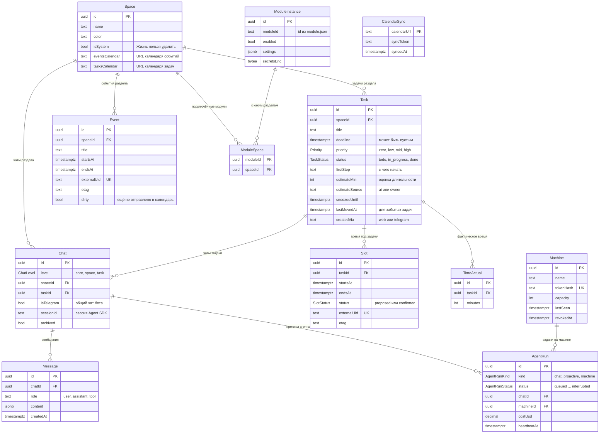

# База данных Life Board

PostgreSQL, схема описана в Prisma: [packages/db/prisma/schema.prisma](../packages/db/prisma/schema.prisma). Начальная миграция сгенерирована из схемы: [0001_init/migration.sql](../packages/db/prisma/migrations/0001_init/migration.sql).

Принципы:

- **Один владелец на установку.** Колонок вроде `owner_id` нет, данные разных людей живут в разных установках.
- **Время в UTC.** Тайм-зона владельца хранится в настройках, в местное время всё переводится при расчётах.
- **Календарь живёт снаружи.** События и слоты хранят `externalUid` и `etag` записи на CalDAV-сервере, а `CalendarSync` хранит sync-token, чтобы после перезапуска не перечитывать календарь целиком.
- **Секреты зашифрованы.** Ключ модели, токен бота и пароль календаря лежат в `Secret` в виде AES-256-GCM, ключ берётся из окружения.

## Схема

Служебные таблицы без связей:

| Таблица | Что хранит |
|---|---|
| `Settings` | Одна строка: тайм-зона, рабочее окно и норма по дням недели, лимит дайджеста, настойчивость, привязанный чат Telegram |
| `DayOverride` | Исключения рабочего окна и нормы на конкретные даты |
| `Owner` | Хэш пароля владельца и счётчик неудачных попыток входа |
| `Session` | Сессии входа; таблица нужна, чтобы работала кнопка «Выйти везде» |
| `Secret` | Зашифрованные ключи и пароли подключений |
| `MemoryNote` | Память ассистента по уровням: общая, раздел, задача |

## Группы таблиц

| Группа | Таблицы | Когда |
|---|---|---|
| Задачи и календарь | `Space`, `Task`, `Slot`, `Event`, `CalendarSync`, `Settings`, `DayOverride` | MVP |
| Ассистент | `Chat`, `Message`, `AgentRun` | MVP |
| Доступ | `Owner`, `Session`, `Secret` | MVP |
| Расширения | `ModuleInstance`, `ModuleSpace`, `Machine` | После MVP |
| Обучение | `MemoryNote`, `TimeActual` | После MVP |

## Что важно в связях

- **Удаление раздела** каскадом удаляет его задачи, события и слоты. Чаты остаются: у них обнуляется ссылка на раздел, история не теряется.
- **Слот со статусом `confirmed`** система не двигает. При накладке переносится только `proposed`.
- **`AgentRun`** разбирается очередью через `SELECT ... FOR UPDATE SKIP LOCKED` по индексу `(status, kind, createdAt)`. Прогон без свежего `heartbeatAt` переводится в `interrupted`.
- **`Task.estimateSource = owner`** означает, что оценку поправил владелец, и модель её больше не перезаписывает.
- **Технические фоновые задачи** (синхронизация, тики, отправка сообщений) живут в отдельной схеме `pgboss`, которой управляет библиотека pg-boss. В эту диаграмму она не входит.
